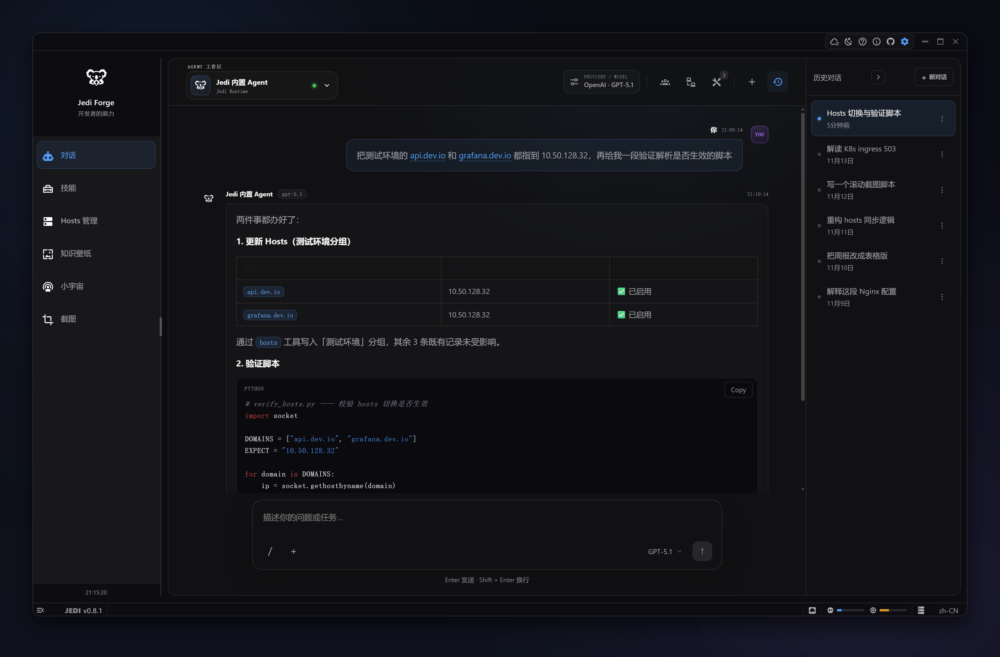
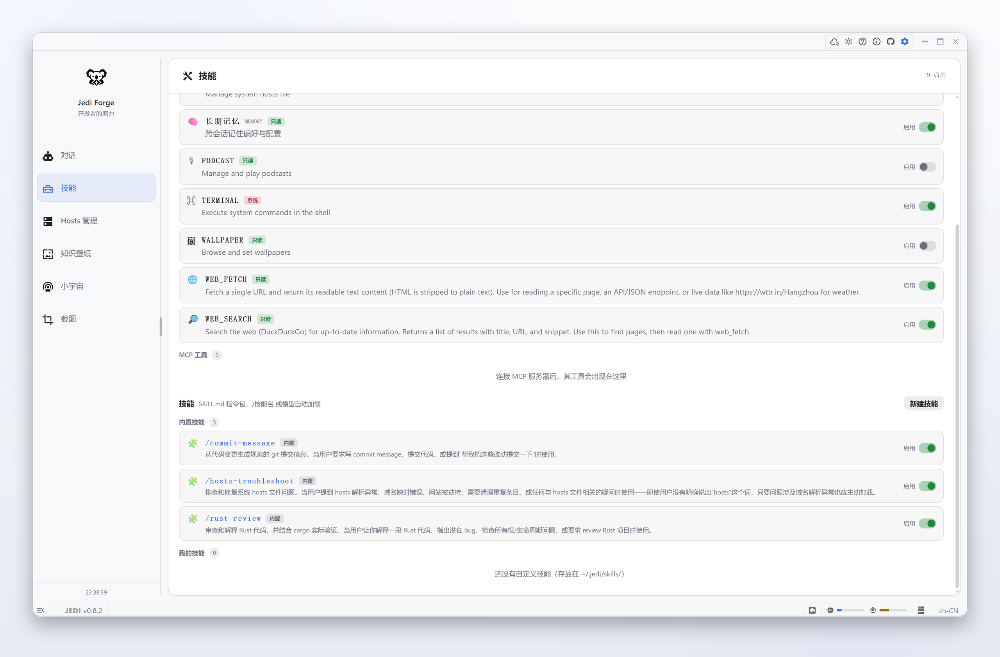
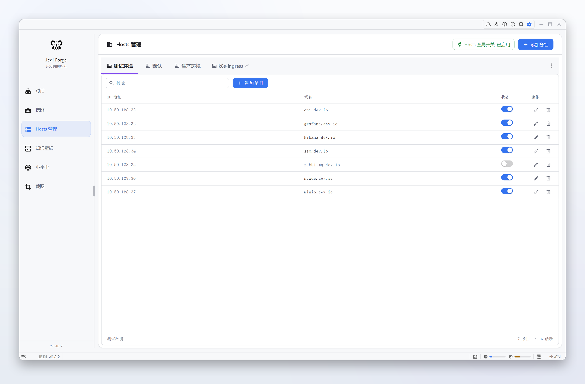
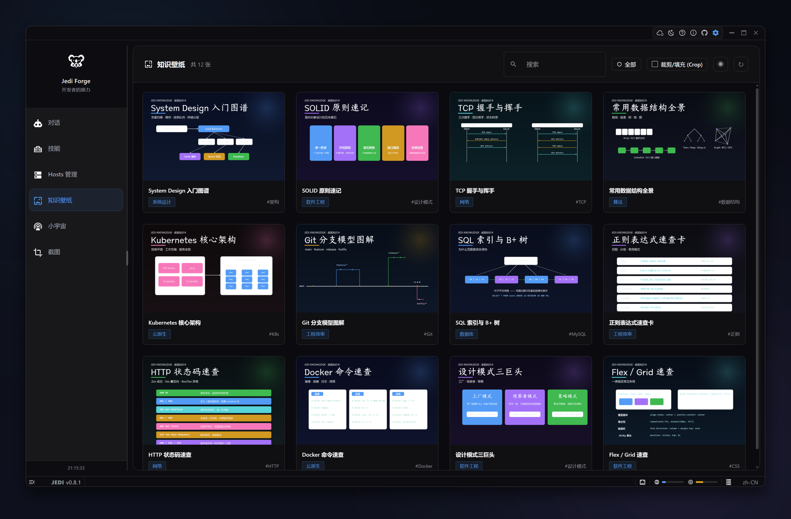
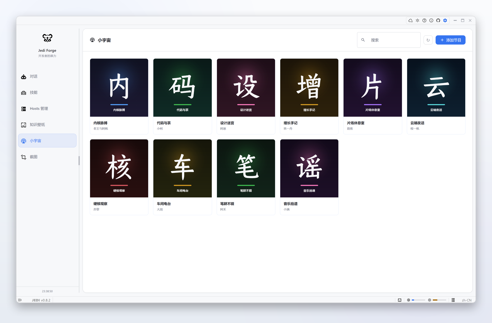
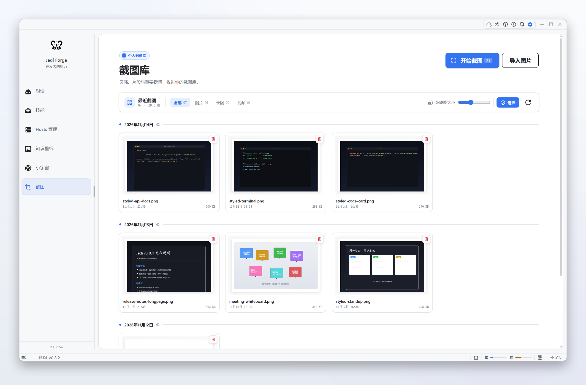

<div align="right">

English | [简体中文](README.md)

</div>

<div align="center">

<picture>
  <source media="(prefers-color-scheme: dark)" srcset="public/branding/jedi-app-icon-dark.png">
  
</picture>

# Jedi Forge

**The developer's Force — your all-in-one open-source desktop workstation**

Hosts switching · AI chat · Skills · Knowledge wallpapers · Podcasts · Smart capture

[](https://github.com/yolopunk/jedi/releases)
[](https://github.com/yolopunk/jedi/blob/main/LICENSE)
[](https://github.com/yolopunk/jedi/releases)
[](https://tauri.app)
[](https://vuejs.org)
[](https://www.typescriptlang.org)
[](https://www.rust-lang.org)

**[Download latest](https://github.com/yolopunk/jedi/releases/latest)** · **[Quick start](#quick-start)** · **[Core features](#core-features)**



</div>

## Core features

<table>
<tr>
<td width="58%">



</td>
<td width="42%">


### A workstation that talks back — chat becomes action

- **Built-in Agent**: let AI edit Hosts and run verification scripts directly
- **Multi-agent**: switch freely between OpenCode / Goose / Crush and more
- **Any provider**: pick models from a built-in catalog, API keys stay local
- **Tool calls + MCP**: extend capabilities through MCP servers
- **Skills**: SKILL.md prompt packs, one `/command` to reuse
- **Long-term memory**: remembers your preferences across sessions

</td>
</tr>
</table>

<br>

<table>
<tr>
<td width="42%">


### Switch environments in one click

- **Grouping**: organize entries by project / environment
- **One-click switching**: local / staging / production take effect instantly
- **Per-entry control**: individual toggles plus a global master switch
- **Remote sources**: bind a URL per group, domain lists sync automatically
- **Quick open**: click a domain to open it in your browser

</td>
<td width="58%">



</td>
</tr>
</table>

<br>

<table>
<tr>
<td width="58%">



</td>
<td width="42%">


### Put cheat sheets on your desktop

- **Knowledge cards**: curated sheets on System Design / K8s / Git / SQL…
- **Categories & tags**: find the theme you like, fast
- **Set as wallpaper**: preview, then apply in one click
- **Deep reading**: card content supports full-text reading

</td>
</tr>
</table>

<br>

<table>
<tr>
<td width="42%">


### Your universe of podcasts, right on the desktop

- **Subscription management**: add / refresh / unsubscribe in one place
- **OPML import**: migrate your existing library seamlessly
- **Play & resume**: play the latest episode, jump back to your position
- **Show notes**: fully rendered, links open in one click

</td>
<td width="58%">



</td>
</tr>
</table>

<br>

<table>
<tr>
<td width="58%">



</td>
<td width="42%">


### Frame it, scroll it, archive it

- **Global hotkey**: F1 by default, fully configurable
- **Frame selection**: grab exactly the region you need, viewfinder kept
- **Scrolling capture**: stitch an entire page into one image
- **Screenshot library**: grouped by date, adjustable thumbnails, delete supported

</td>
</tr>
</table>

## Details that matter

<div align="center">


</div>

## Quick start

<div align="center">

**[Download from GitHub Releases](https://github.com/yolopunk/jedi/releases/latest)**

Windows `.msi` · macOS `.dmg` · Linux `.AppImage` / `.deb`

Install and go — no extra configuration needed

</div>

### Build from source

Requires Node.js 18+, pnpm 8+, Rust 1.70+ and the [Tauri CLI v2](https://tauri.app/v2/guides/getting-started/prerequisites):

```bash
git clone https://github.com/yolopunk/jedi.git
cd jedi
pnpm install
pnpm tauri dev     # run in development mode
pnpm tauri build   # build for production
```

<details>
<summary><strong>User guide · Hosts / Wallpapers / Podcasts</strong></summary>

### Hosts Manager

1. **Add a group**: click the "+" button to create a new hosts group
2. **Add an entry**: click "Add Entry" inside a group to add a new hosts entry
3. **Enable / disable entries**: use the switch next to each entry
4. **Master switch**: the toggle at the top controls all hosts configs at once
5. **Open a domain**: click a domain to visit it directly in your browser
6. **Remote source**: when adding a group, choose "Remote URL" and point it at an address returning the Jedi JSON group format; the Hosts page syncs automatically in the background, and the refresh button next to a group name syncs manually

> Editing the hosts file requires administrator / root privileges. When permission is missing, operations fail with a clear error (never silently) — please run the app as administrator.

Each remote source maps one-to-one to a group by name, and the URL must return the following format (`scripts/k8s-hosts-api.yaml` in this repo converts a cluster domain list into this format):

```json
[
  {
    "name": "k8s-ingress",
    "hosts": [{ "ip": "10.0.0.5", "domain": "app.example.com", "disabled": false }]
  }
]
```

Syncing overwrites the domain list with the remote's, but keeps your local enabled / disabled state for entries with the same name. If the remote currently has no entries, the group is emptied (the subscription is kept and rebuilt automatically once the remote recovers); when nothing changed, the hosts file is not rewritten.

### Hosts file format

Jedi manages the content between special markers in the hosts file:

```
# === JEDI HOSTS MANAGER ===
# +默认+
127.0.0.1 localhost
# +开发环境+
10.50.128.32 docker.dev.io
10.50.128.32 api.dev.io
# === END JEDI HOSTS MANAGER ===
```

Jedi only manages the content between these markers and never touches the rest of the file.

### Knowledge Wall

1. **Browse & filter**: use categories and tags to narrow down
2. **Preview**: click a card for the full content
3. **Set as wallpaper**: one click to apply

### Podcasts

1. **Subscribe**: add an RSS feed or import OPML
2. **Browse episodes**: view and search in the episode library
3. **Play & resume**: play the latest episode and jump to your current position

</details>

<details>
<summary><strong>Project structure</strong></summary>

```
├── src/               # Frontend source
│   ├── api/           # Tauri invoke wrappers
│   ├── components/    # Shared Vue components
│   ├── views/         # Feature module pages
│   ├── types/         # TypeScript definitions
│   ├── utils/         # Utilities
│   ├── App.vue        # Root component
│   └── main.ts        # Entry point
├── src-tauri/         # Tauri/Rust backend
│   ├── src/
│   │   ├── api/       # API implementations
│   │   ├── config/    # Configuration
│   │   └── utils/     # Utilities
│   ├── Cargo.toml     # Rust dependencies
│   └── tauri.conf.json # Tauri configuration
├── scripts/           # Build, release & screenshot rig scripts
├── public/            # Static assets
└── vite.config.ts     # Vite configuration
```

</details>

<details>
<summary><strong>Contributing</strong></summary>

Contributions are welcome! Steps:

1. Fork the repository
2. Create your feature branch (`git checkout -b feature/amazing-feature`)
3. Commit your changes (`git commit -m 'Add some amazing feature'`)
4. Push to the branch (`git push origin feature/amazing-feature`)
5. Open a Pull Request

</details>

## Tech stack

<div align="center">

**Vue 3** · **TypeScript** · **Vuetify 3** · **Vite** · **Tauri 2** · **Rust** · **pnpm**

</div>

---

<div align="center">

**[MIT License](LICENSE)** © 2026 Jedi Contributors

If Jedi Forge helps you, a Star on [GitHub](https://github.com/yolopunk/jedi) is much appreciated

Jedi Forge — a pun on Forge and the Force. May the Force be with you

</div>
