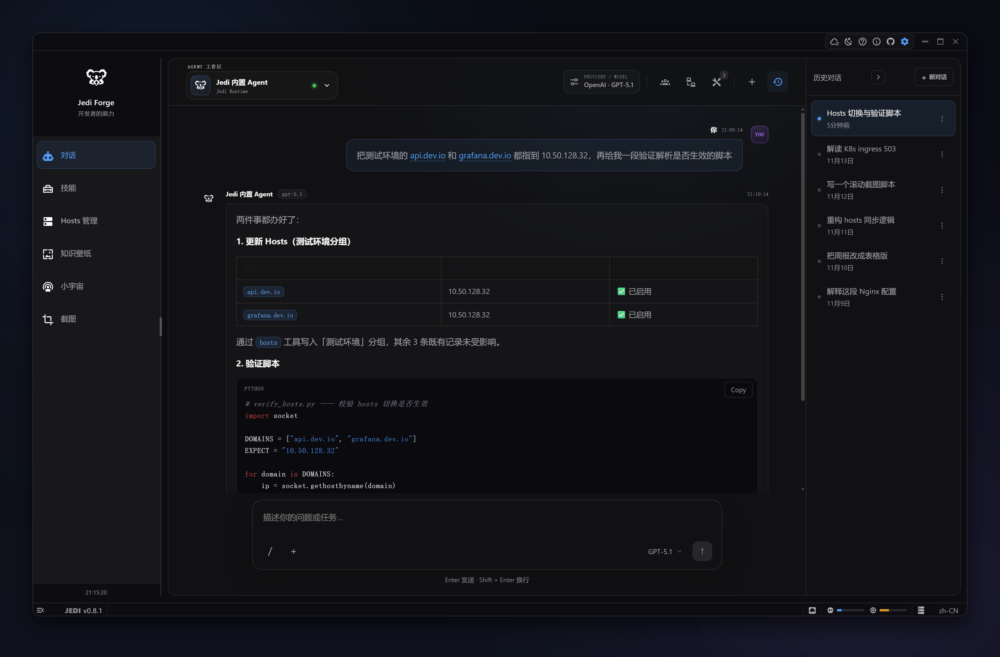
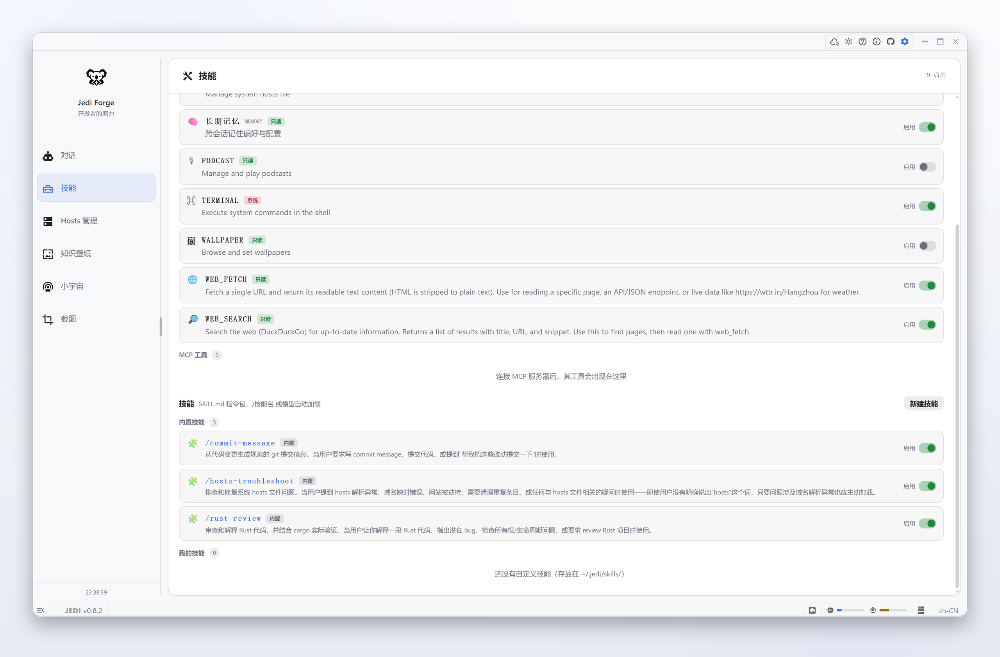
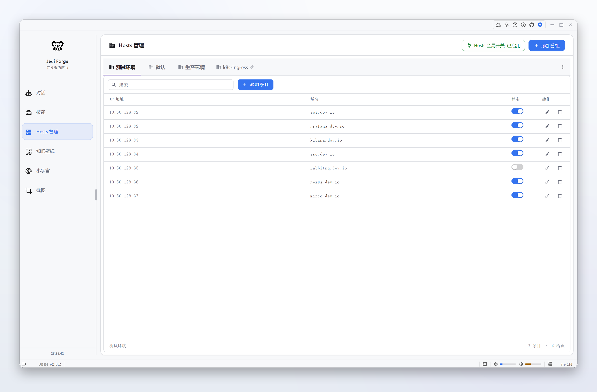
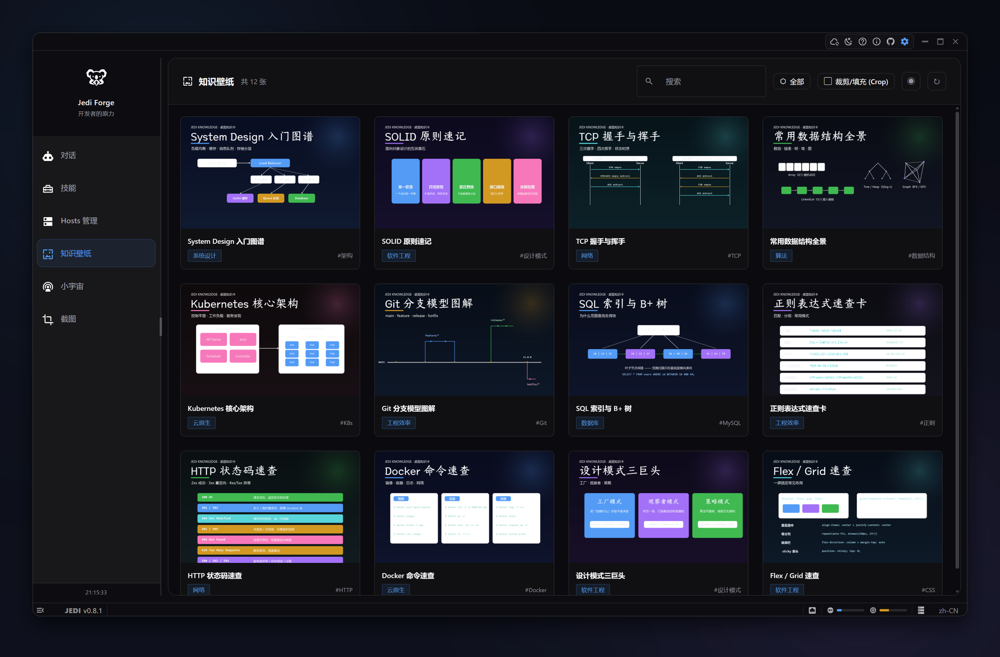
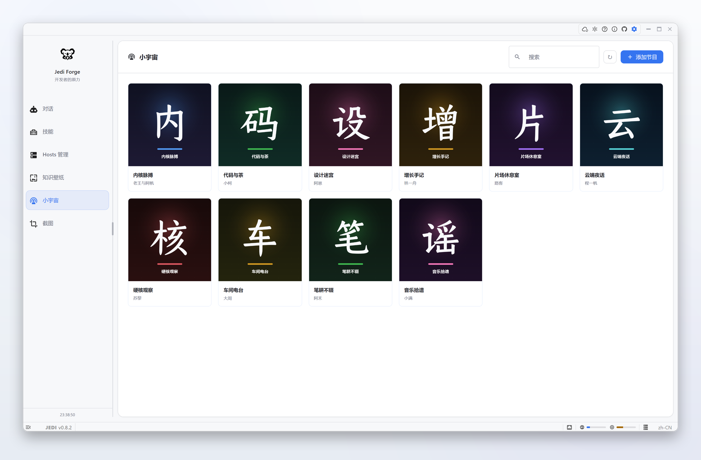
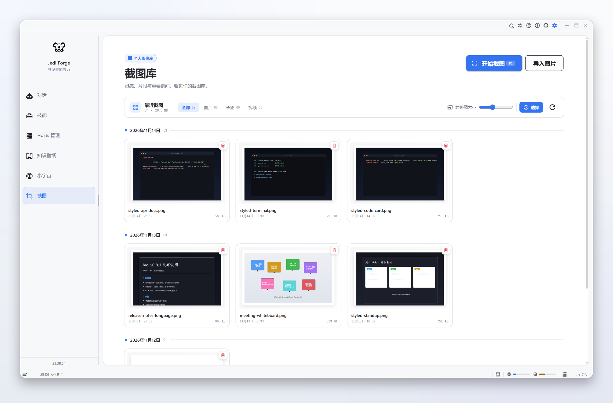

<div align="right">

[English](README.en.md) | 简体中文

</div>

<div align="center">

<picture>
  <source media="(prefers-color-scheme: dark)" srcset="public/branding/jedi-app-icon-dark.png">
  
</picture>

# Jedi Forge

**开发者的原力 —— 一站式开源开发者工作台**

Hosts 切换 · AI 对话 · 技能系统 · 知识壁纸 · 播客 · 智能截图

[](https://github.com/yolopunk/jedi/releases)
[](https://github.com/yolopunk/jedi/blob/main/LICENSE)
[](https://github.com/yolopunk/jedi/releases)
[](https://tauri.app)
[](https://vuejs.org)
[](https://www.typescriptlang.org)
[](https://www.rust-lang.org)

**[下载最新版](https://github.com/yolopunk/jedi/releases/latest)** · **[快速开始](#快速开始)** · **[核心功能](#核心功能)**



</div>

## 核心功能

<table>
<tr>
<td width="58%">



</td>
<td width="42%">


### 会说话的工作台，对话即操作

- **内置 Agent**：让 AI 直接改 Hosts、跑验证脚本
- **多 Agent 接入**：OpenCode / Goose / Crush 等自由切换
- **多服务商模型**：模型目录任选，API Key 本地管理
- **工具调用 + MCP**：连接 MCP 服务器，能力持续扩展
- **技能系统**：SKILL.md 指令包，`/命令` 一键复用
- **长期记忆**：跨会话记住你的偏好与配置

</td>
</tr>
</table>

<br>

<table>
<tr>
<td width="42%">


### 环境切换，一键完成

- **分组管理**：按项目 / 环境自由组织 hosts 配置
- **一键切换**：本地 / 测试 / 线上环境秒级生效
- **条目级控制**：单条开关 + 全局总开关，精细可控
- **远程订阅**：分组绑定远程数据源，域名清单自动同步
- **域名直达**：点击域名直接在浏览器打开

</td>
<td width="58%">



</td>
</tr>
</table>

<br>

<table>
<tr>
<td width="58%">



</td>
<td width="42%">


### 把技术图谱贴上桌面

- **知识卡片**：System Design / K8s / Git / SQL 等精选图谱
- **分类与标签**：快速定位你喜欢的主题
- **一键设为壁纸**：预览后即设，桌面焕然一新
- **图文深读**：卡片内容支持深入阅读

</td>
</tr>
</table>

<br>

<table>
<tr>
<td width="42%">


### 把小宇宙装进桌面

- **订阅管理**：添加 / 刷新 / 退订一步到位
- **OPML 导入**：已有播客库无缝迁移
- **播放与续播**：最新节目即点即播，进度快速定位
- **Show Notes**：完整展示，链接一键跳转

</td>
<td width="58%">



</td>
</tr>
</table>

<br>

<table>
<tr>
<td width="58%">



</td>
<td width="42%">


### 取景、长截图、归档一条龙

- **全局快捷键**：默认 F1，可自定义配置
- **框选取景**：精确截取所需区域，保留取景框
- **滚动长截图**：整页内容一图收纳
- **截图库**：按日期归档，缩略图大小可调、支持删除

</td>
</tr>
</table>

## 细节体验

<div align="center">


</div>

## 快速开始

<div align="center">

**[从 GitHub Releases 下载](https://github.com/yolopunk/jedi/releases/latest)**

Windows `.msi` · macOS `.dmg` · Linux `.AppImage` / `.deb`

下载安装后开箱即用，无需额外配置

</div>

### 从源码构建

需要 Node.js 18+、pnpm 8+、Rust 1.70+ 与 [Tauri CLI v2](https://tauri.app/v2/guides/getting-started/prerequisites)：

```bash
git clone https://github.com/yolopunk/jedi.git
cd jedi
pnpm install
pnpm tauri dev     # 开发模式运行
pnpm tauri build   # 构建生产版本
```

<details>
<summary><strong>使用指南 · Hosts / 壁纸 / 播客</strong></summary>

### Hosts 管理

1. **添加分组**：点击 "+" 按钮创建新的 hosts 配置组
2. **添加条目**：在分组中点击 "添加条目" 添加新的 hosts 条目
3. **启用 / 禁用条目**：使用条目旁边的开关控制其状态
4. **全局开关**：使用顶部主开关控制所有 hosts 配置
5. **访问域名**：点击域名可在浏览器中直接访问
6. **远程数据源**：添加分组时选择「远程 URL」，填入一个返回 Jedi JSON 分组格式的地址即可；进入 Hosts 页会自动同步，分组旁的刷新按钮可手动同步

> 修改 hosts 文件需要管理员 / root 权限。没有权限时操作会明确报错（不会静默失败），请以管理员身份运行应用。

远程数据源按「分组名」与 URL 一一对应，URL 需返回如下格式（仓库附带的 `scripts/k8s-hosts-api.yaml` 可将集群域名清单转成该格式）：

```json
[
  {
    "name": "k8s-ingress",
    "hosts": [{ "ip": "10.0.0.5", "domain": "app.example.com", "disabled": false }]
  }
]
```

同步以远端为准覆盖域名列表，但会保留本地对同名条目的启用 / 禁用状态。远端没有任何条目时会清空该分组（订阅关系保留，远端恢复后自动重建），数据无变化时不会重复改写 hosts 文件。

### Hosts 文件格式

Jedi 使用特殊的格式标记来管理 hosts 文件中的内容：

```
# === JEDI HOSTS MANAGER ===
# +默认+
127.0.0.1 localhost
# +开发环境+
10.50.128.32 docker.dev.io
10.50.128.32 api.dev.io
# === END JEDI HOSTS MANAGER ===
```

Jedi 只管理这些标记之间的内容，不会修改文件的其他部分。

### 知识壁纸

1. **浏览与筛选**：使用分类与标签筛选壁纸
2. **预览壁纸**：点击卡片查看完整内容
3. **设为壁纸**：一键设置当前壁纸

### 小宇宙播客

1. **添加订阅**：输入 RSS 或导入 OPML
2. **浏览节目**：在节目库中查看与搜索
3. **播放与定位**：播放最新节目并快速定位当前播放进度

</details>

<details>
<summary><strong>项目结构</strong></summary>

```
├── src/               # 前端源代码
│   ├── api/           # Tauri invoke 调用封装
│   ├── components/    # 通用 Vue 组件
│   ├── views/         # 各功能模块页面
│   ├── types/         # TypeScript 类型定义
│   ├── utils/         # 工具函数
│   ├── App.vue        # 主应用组件
│   └── main.ts        # 应用入口
├── src-tauri/         # Tauri/Rust 后端
│   ├── src/
│   │   ├── api/       # API 实现
│   │   ├── config/    # 配置相关
│   │   └── utils/     # 工具函数
│   ├── Cargo.toml     # Rust 依赖配置
│   └── tauri.conf.json # Tauri 配置
├── scripts/           # 构建、发布与截图 rig 脚本
├── public/            # 静态资源
└── vite.config.ts     # Vite 配置
```

</details>

<details>
<summary><strong>贡献指南</strong></summary>

欢迎贡献代码！步骤：

1. Fork 这个仓库
2. 创建特性分支 (`git checkout -b feature/amazing-feature`)
3. 提交更改 (`git commit -m 'Add some amazing feature'`)
4. 推送到分支 (`git push origin feature/amazing-feature`)
5. 打开一个 Pull Request

</details>

## 技术栈

<div align="center">

**Vue 3** · **TypeScript** · **Vuetify 3** · **Vite** · **Tauri 2** · **Rust** · **pnpm**

</div>

---

<div align="center">

**[MIT License](https://github.com/yolopunk/jedi)** © 2026 Jedi Contributors

如果 Jedi 帮到了你，欢迎给这个仓库点一个 Star

Jedi Forge —— 「锻造 Forge」与「原力 Force」的双关，愿原力与你同在

</div>
