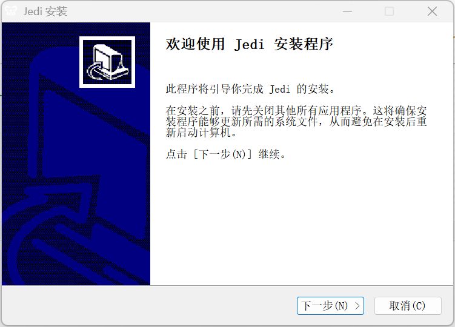
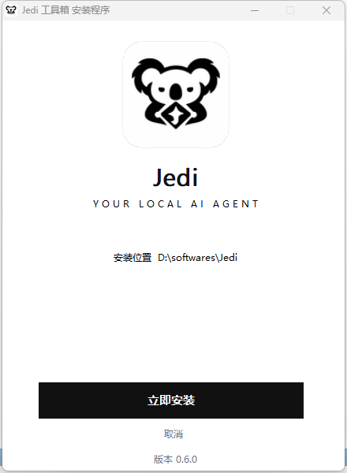
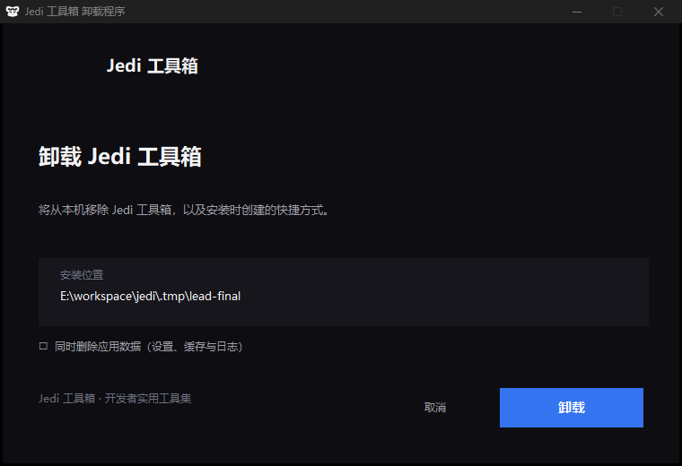
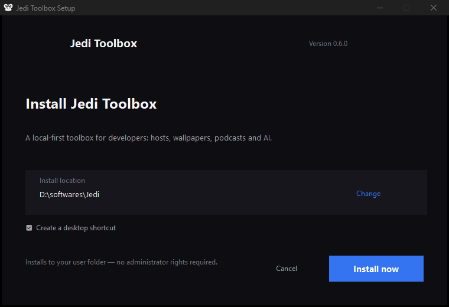

# Jedi 安装包界面改造（Windows NSIS）— 设计规格

- 日期：2026-11-04
- 范围：Windows NSIS 安装/卸载程序界面（`bundle.windows.nsis`）
- 基线：Tauri CLI 2.10.1 内置 `installer.nsi` 模板
- 目标：把默认的「蓝色经典 MUI 模板 + 英文 boilerplate」改造成与 Jedi 品牌一致、中文优先、现代感的安装体验。

> **版本说明（2026-11-04 22:30 更新）**
> 产品评审认为「MUI 向导 + 换皮」仍不够现代，最终选定 **单窗口无向导（single-window）** 方案。
> 第 3 章的多页视觉规格（深色侧栏 + 白色内容页 + 150×57 铭牌）作为**过渡方案**保留，仅 `sidebar.bmp` / `header.bmp` 为遗留资源；
> 最终实现以 **第 7 章「单窗口方案（v2，最终）」** 为准。第 4、5、6 章的工程约束与验证协议继续有效。

---

## 1. 现状（改前）

实测（Windows 11，150% 缩放，`Jedi_0.4.0_x64-setup.exe`）：

| 问题 | 说明 |
|---|---|
| 语言 | 全部英文文案；中文系统也显示英文 |
| 视觉 | NSIS 自带的蓝色经典侧栏图；无任何品牌元素 |
| 文案 | "Setup will guide you through the installation of Jedi." + 关闭其他程序的通用建议，没有产品价值说明 |
| 页面 | 欢迎 → 目录 → 进度 → 完成，缺少安装选项页；桌面快捷方式被伪装成「显示自述文件」复选框 |
| 字体 | 中文系统 MUI 默认 `宋体 9pt`（SimpChinese.nlf） |
| 收尾 | 完成页没有版本说明/发行说明入口；卸载页没有品牌 |

---

## 2. 设计目标

1. **品牌一致**：深色品牌侧栏 + 白色内容页，和 Jedi 启动页（黑洞 + Koala 标志）同一套语言。
2. **中文优先**：默认跟随系统语言；简体中文 / 英文双语言，全部自有文案都要有双语。
3. **信息有用**：欢迎页说明这是什么工具、装到哪、多大、需要什么权限；选项页集中所有勾选项。
4. **有始有终**：完成页可立即启动 + 查看发行说明；卸载页有品牌且有数据删除勾选项。
5. **可维护**：自定义模板保持 Tauri 的 `{{占位符}}`、`installerHooks`、被动/静默/更新模式行为不变；模板头部注明基线版本与来源。

---

## 3. 视觉规格

### 3.1 色彩（取自 `src/assets/theme.css`）

| 令牌 | 值 | 用途 |
|---|---|---|
| 深色底（上） | `#16161C` | 侧栏渐变起点 |
| 深色底（下） | `#0A0A0E` | 侧栏渐变终点 |
| 品牌蓝 | `#3574F0` | 强调线、进度条、链接、勾选标记 |
| 深色光晕 | `#539BF5` | 侧栏顶部径向光晕（≤16% 不透明度） |
| 深色主文字 | `#F4F4F5` | 侧栏标题 |
| 深色次文字 | `#A1A1AA` | 侧栏副标题 |
| 深色弱文字 | `#6C707E` | 侧栏底部说明 |
| 页面主文字 | `#27282E` | 内容页正文（由系统控件绘制） |
| 页面次文字 | `#6C707E` | 内容页说明 |
| 页面底 | `#FFFFFF` | 内容页背景（与 MUI 页面一致） |

字体：
- 内容页文本：安装器运行时统一改为 `Microsoft YaHei UI 9pt`（中文）/ `Segoe UI 9pt`（英文），替换 MUI 默认的 `宋体 9pt`。
- 侧栏位图文字：仓库内 `public/fonts/CangErJinKai05-W04.ttf`（品牌展示字体），仅用于「Jedi 工具箱」字标。

> 实测结论：`LangString ^Font ${LANG_SIMPCHINESE} "Microsoft YaHei UI"` + `LangString ^FontSize ${LANG_SIMPCHINESE} "9"` 可以覆盖 MUI 字体（已验证编译并截图）。

### 3.2 位图资源

> 纯位图，无 alpha。必须 24-bit BMP（NSIS 兼容性最好）。

**`src-tauri/windows/nsis/sidebar.bmp` — 164 × 314**

- 深色渐变底 `#16161C → #0A0A0E`，顶部居中蓝色径向光晕。
- 白色 Koala 标志（`public/branding/jedi-mark-white.svg` 光栅化），宽约 64px，居中，距顶 ~42px。
- 字标「Jedi 工具箱」：品牌展示字体，约 20px，白色，距顶 ~132px。
- 一行副标题「开发者实用工具集」：11px，`#A1A1AA`。
- 英文小字 `DEVELOPER TOOLBOX`：8px，字间距 +1.5，`#6C707E`（可选，与副标题二选一不并存）。
- 40 × 2px 品牌蓝短线（`#3574F0`，80% 不透明度）作视觉分隔。
- 底部三行弱文字（9px，`#6C707E`，行距 14）：
  `本地优先 · 无需账号`
  `Hosts · 壁纸 · 播客 · AI`
  （第三行留空或放 `WINDOWS 10 / 11`）
- 不出现版本号（版本会变，位图是静态资源）。
- 设计约束：系统会按 DPI 拉伸（150% 时 164×314 → 246×471），所以**只用大色块与大字号**，禁止 1px 细线、小号密集文字（会糊）。

**`src-tauri/windows/nsis/header.bmp` — 150 × 57**

- 深色品牌条：底色 `#111113`，左侧 3px 品牌蓝 `#3574F0` 竖条，整块与白色内容页形成「品牌铭牌」对比。
- 白色 Koala 标志（约 30px 高，`jedi-mark-white`）。
- 右侧两行文字：「Jedi 工具箱」13px 粗体白色 `#F4F4F5`；「安装程序」9px `#A1A1AA`。
- 同样只用大字号、粗笔画。

**图标（纯白 logo）**

按产品要求：系统托盘、任务栏/窗口图标、安装器界面统一使用**白色 Koala 标志（透明背景，无深色底板）**。

- `src-tauri/icons/tray-icon.png`：64×64 白色标志，透明背景（Windows/Linux 托盘）。
- `src-tauri/icons/icon.ico`：多尺寸（16/24/32/48/64/128/256）白色标志，透明背景；用于窗口标题栏、任务栏按钮、安装器图标。
- `src-tauri/icons/32x32.png`、`128x128.png`、`128x128@2x.png`、`icon.png`：同款白色标志，透明背景。
- `src-tauri/icons/tray-template.png`（macOS 模板图标，黑色单色）与 `icon.icns` 保持不变：macOS 由系统按模板渲染，白底环境需要深色图形。
- 已知取舍（已与产品确认）：纯白标志在浅色任务栏/浅色窗口标题栏上对比偏弱，换取深色环境下最干净的观感。

**图标**：沿用 `src-tauri/icons/icon.ico`（Koala 应用图标）。

### 3.3 文案（中文 / 英文）

**欢迎页**

- 标题：`欢迎安装 Jedi 工具箱` / `Welcome to Jedi Toolbox`
- 正文（`$\r$\n` 换行）：

```
版本 {{VERSION}} · 适用于 Windows 10 / 11（64 位）

Jedi 工具箱是一款面向开发者的本地实用工具集：

  · Hosts 管理 —— 分组、一键切换、远程源同步
  · 知识壁纸 —— 精选壁纸库，一键设为桌面
  · 播客客户端 —— 订阅、播放与 OPML 导入
  · AI 助手 —— 多模型对话与技能调度

安装到当前用户目录，无需管理员权限。
点击「下一步」继续。
```

**安装选项页（新增）**

- 标题 `安装选项` / `Install options`
- 副标题 `选择快捷方式，然后继续安装。` / `Choose shortcuts, then continue.`
- 分组标签 `快捷方式` / `Shortcuts`
- 复选框 1：`创建桌面快捷方式` / `Create a desktop shortcut`（默认勾选）
- 复选框 2：`创建开始菜单快捷方式` / `Create a Start Menu shortcut`（默认勾选）
- 分隔线
- 信息行：`安装位置：<INSTDIR>` / `Install location: <INSTDIR>`
- 信息行：`所需空间：约 <N> MB`（由 `${ESTIMATEDSIZE}` 换算）
- 弱提示：`安装到当前用户目录，无需管理员权限。` / `Installs to your user folder — no administrator rights required.`

**进度页**

- 标题 `正在安装` / `Installing`
- 副标题 `正在复制文件并写入注册表，请稍候…` / `Copying files and registering the app…`
- 进度条：品牌蓝（`PBM_SETBARCOLOR`，配 `SetWindowTheme` 关闭主题化；失败要静默降级，不影响安装）。

**完成页**

- 标题 `Jedi 工具箱已安装完成` / `Jedi Toolbox is installed`
- 正文 `可以从开始菜单或桌面快捷方式启动。感谢使用！` / `Launch it from the Start Menu or your desktop shortcut. Thanks for using Jedi!`
- 运行复选框：`立即启动 Jedi 工具箱` / `Run Jedi Toolbox now`（默认勾选）
- 底部链接：`查看发行说明` / `View release notes` → `https://github.com/yolopunk/jedi/releases`

**卸载页**

- 确认页标题 `卸载 Jedi 工具箱` / `Uninstall Jedi Toolbox`
- 保留原有勾选项语义，文案：`同时删除应用数据（设置、缓存与日志）` / `Also delete app data (settings, cache, logs)`
- 完成页标题 `卸载完成` / `Uninstall complete`

**其它**

- 窗口标题：`Jedi 工具箱 安装程序` / `Jedi Toolbox Setup`（`.onGUIInit` 内 `SetWindowText`，不要改 `Name` 指令）
- 底部品牌文字（`BrandingText`）：`Jedi 工具箱 · 开发者实用工具集` / `Jedi Toolbox · Developer utilities`
- 维护页（已安装同版本/升级/降级）沿用模板既有逻辑，文案保持 Tauri 的 `$(...)` 字符串，不重复造轮子。

---

## 4. 技术约束

### 4.1 模板

- 文件：`src-tauri/windows/nsis/installer.nsi`
- 基线：`https://raw.githubusercontent.com/tauri-apps/tauri/tauri-cli-v2.10.1/crates/tauri-bundler/src/bundle/windows/nsis/installer.nsi`（Tauri CLI 2.10.1 实际使用的版本；本机旧构建产物 `src-tauri/target/release/nsis/x64/installer.nsi` 是同一模板代入值后的结果，可用于对照）。
- **必须原样保留**所有 `{{...}}` 占位符与 Handlebars 段（`{{#if}}`、`{{#each}}`、`{{or}}`、`{{no-escape}}` 等），否则打包会失败或产物错误。
- 必须保留 `!ifmacrodef NSIS_HOOK_PREINSTALL/POSTINSTALL/PREUNINSTALL/POSTUNINSTALL` 钩子。
- 必须保留被动（`/P`）、静默（`/S`）、更新（`/UPDATE`）、`/NS`、`/R`、`/ARGS` 行为。
- 新增语言字符串用 `LangString xxx ${LANG_SIMPCHINESE} "…"` / `${LANG_ENGLISH} "…"` 成对定义；`installer.nsi` 里不允许出现只有一种语言的用户可见文案。
- 新增页面用 `Page custom`（MUI 内页样式），并遵守：
  - 被动 / 更新模式下 `Abort` 跳过；
  - 页面离开时把勾选状态写入变量；
  - `nsDialogs` 布局用 dialog unit（`u`），并 `nsDialogs::SetRTL` 处理 RTL。
- 桌面快捷方式：删除模板中「用完成页 SHOWREADME 复选框顺手创建桌面快捷方式」的做法，改由安装选项页变量决定，在 `Section Install` 里创建；被动/静默模式保持默认创建（与旧行为一致）。
- 开始菜单快捷方式：选项页取消勾选时置 `$NoShortcutMode = 1`，复用模板已有 `CreateOrUpdateStartMenuShortcut` 逻辑。
- 卸载页：保留 `DeleteAppDataCheckbox` 机制，仅改文案与标题。

### 4.2 配置（由 Lead 修改）

`src-tauri/tauri.conf.json`：

```jsonc
"bundle": {
  "windows": {
    "nsis": {
      "template": "windows/nsis/installer.nsi",
      "installerIcon": "icons/icon.ico",
      "sidebarImage": "windows/nsis/sidebar.bmp",
      "headerImage": "windows/nsis/header.bmp",
      "languages": ["SimpChinese", "English"],
      "displayLanguageSelector": false
    }
  }
}
```

（路径相对 `src-tauri/`；`plugins.windows.installMode: "passive"` 保持不变，它只影响应用内更新。）

---

## 5. 验证协议

1. **编译**：用本机 NSIS 编译自定义模板必须 0 error。命令示例：
   ```
   & "$env:LOCALAPPDATA\tauri\NSIS\makensis.exe" /V2 path\to\installer.nsi
   ```
2. **页面渲染**：走预览工具（`scripts/preview-installer.mjs` + `scripts/capture-installer.ps1`），在**不真正写入系统**的前提下逐页截图：
   - 欢迎页、安装选项页、目录页、进度页、完成页、卸载确认页
   - 中文 + 英文两种语言各一套
3. **安全**：任何验证都不得真实安装、写注册表、创建快捷方式或删除文件；Install/Uninstall 的副作用必须被替换为空操作（`DetailPrint` + `Sleep`）。
4. **回归**：最终由 Lead 跑一次真实的 `pnpm tauri build --bundles nsis` 验证端到端产物。

---

## 6. 文件所有权（避免并行冲突）

| 路径 | 负责人 |
|---|---|
| `src-tauri/windows/nsis/sidebar.bmp`、`header.bmp`、`scripts/gen-installer-art.py` | installer-art |
| `src-tauri/windows/nsis/installer.nsi` | installer-template |
| `scripts/preview-installer.mjs`、`scripts/capture-installer.ps1`、`.tmp/**` | installer-qa |
| `src-tauri/tauri.conf.json`、`docs/**` | Lead |

---

## 7. 单窗口方案（v2，最终）

### 7.1 结论与理由

MUI 多页向导即使做了品牌化，仍然保留「灰色对话框 + 系统按钮 + 翻页」的经典观感。产品要求更换为**单窗口、无向导**的安装界面：一次只看到一件事，所有状态在同一窗口内切换。

工程上可行的关键点（均已在本机验证，探针：`.tmp/probe2/probe3.nsi`）：

| 能力 | 实现方式 |
|---|---|
| 任意窗口尺寸 | `SetWindowPos($HWNDPARENT, 0, x, y, W, H, SWP_NOZORDER)`，W/H 按 `GetDpiForWindow` 换算 |
| 整窗画布 | `nsDialogs::Create 1018` 后把内页对话框 `SetWindowPos` 拉伸到整个客户区 |
| 隐藏向导 | `ShowWindow` 隐藏 Next/Back/Cancel、Branding、分隔线、页头（8 个控件） |
| 深色标题栏 | `DwmSetWindowAttribute($HWNDPARENT, 20, &1, 4)`（Win10 20H1+），失败回退属性 id `19` |
| 深色底 | 满幅 static + `SetCtlColors` 纯色（不用大位图，避免 DPI 拉伸模糊） |
| 清晰文字 | 所有文案都是控件，`CreateFont "Microsoft YaHei UI"` + `SetWindowPos` 像素级排版 |
| 可点击按钮 | 带 `SS_NOTIFY` 的 static + `${NSD_OnClick}` |
| Logo | `${NSD_CreateBitmap}` + `${NSD_SetImage}` 加载 `logo.bmp`（纯色底、无 alpha） |
| 进度条 | 轨道 + 填充两个 static，按进度改填充宽度 |

### 7.2 视觉规格

窗口：**760 × 520** 逻辑像素（按 DPI 缩放，居中），不可最大化，深色标题栏，标题「Jedi 工具箱 安装程序」/「Jedi Toolbox Setup」。

| 令牌 | 值 | 用途 |
|---|---|---|
| 窗口底 | `#0E0E12` | 整窗背景 |
| 卡片 | `#16161C` | 安装位置卡片 / 次级按钮底 |
| 主文字 | `#F4F4F5` | 标题、按钮文字 |
| 次文字 | `#A1A1AA` | 说明行、步骤文字 |
| 弱文字 | `#6C707E` | 底部提示、版本号 |
| 品牌蓝 | `#3574F0` | 主按钮、进度填充、链接 |
| 进度轨道 | `#1E1E24` | 进度条底 |

字体：中文 `Microsoft YaHei UI`，英文 `Segoe UI`。标题 18pt 粗体；说明 10pt；提示 9pt；按钮 10pt 粗体。

### 7.3 状态机（同一窗口内切换，不翻页）

**A · 待安装**
```
[logo 96px]  Jedi 工具箱                                  v0.6.0
             安装 Jedi 工具箱
             本地优先的开发者工具箱：Hosts 管理、知识壁纸、播客与 AI 助手。
             ┌───────────────────────────────────────────────┐
             │ 安装位置   C:\Users\…\AppData\Local\Jedi  更改 │
             └───────────────────────────────────────────────┘
             [ 立即安装 ]        取消
             安装到当前用户目录，无需管理员权限。
```

**B · 安装中**
- 标题「正在安装…」，副标题显示当前步骤（检查运行环境 / 复制程序文件 / 创建快捷方式 / 写入注册表…）。
- 满宽进度条 + 百分比；隐藏按钮与路径卡片。

**C · 完成**
- 标题「安装完成」，副标题「Jedi 工具箱已就绪」。
- 主按钮「启动 Jedi 工具箱」；次级链接「完成」。

**D · 失败**
- 标题「安装失败」，显示错误摘要，主按钮「关闭」。

卸载器同理：待卸载（含「同时删除应用数据（设置、缓存与日志）」开关）→ 卸载中 → 卸载完成。

### 7.4 工程约束（在 §4 基础上追加）

1. **安装逻辑不重复**：把原 `Section Install` 的函数体抽成 `Function JediRunInstall`，单窗口页与 `Section Install` 共用；GUI 安装完成后 `Quit`，不进入 instfiles 页。
2. **被动/静默/更新模式零回归**：自定义页 PRE 里 `Abort`，走原有 `MUI_PAGE_INSTFILES` + `Section Install`；`/P` `/S` `/UPDATE` `/NS` `/R` `/ARGS` 行为与 Tauri 原模板一致。
3. **进度可动**：步骤之间必须 `System::Call 'user32::UpdateWindow(p $HWNDPARENT)'` + 短 `Sleep`，否则单线程安装时界面不刷新。
4. **键盘**：Enter = 主操作，Esc = 取消/关闭（对话框子类化 `WM_KEYDOWN`）；至少保证 Esc 与标题栏 X 可退出。
5. **尺寸自适应**：所有位置/尺寸在运行时按 `dpi = GetDpiForWindow` 换算为像素后再 `SetWindowPos`，禁止写死 96dpi 假设。
6. **不引入大位图背景**：除 `logo.bmp` 外不放装饰位图，避免高 DPI 下糊。
7. **文案双语**：单窗口内所有文案成对 `LangString`（SimpChinese / English）。
8. **验证**：`scripts/capture-installer.ps1` 需支持「同窗口多状态」截图；预览仍需 stub 全部副作用。

### 7.5 资源清单（v2）

| 文件 | 说明 |
|---|---|
| `src-tauri/windows/nsis/logo.bmp` | 192×192，24-bit，白标 + `#0E0E12` 底，无缝 |
| `src-tauri/windows/nsis/installer.nsi` | 单窗口安装/卸载 UI + 保留全部安装逻辑 |
| `src-tauri/windows/nsis/sidebar.bmp`、`header.bmp` | v1 遗留资源，v2 不再引用（保留备查） |
| `src-tauri/icons/*` | 纯白透明图标（托盘/任务栏/安装器/窗口） |

---

## 9. 最终实现（v3 · 白底极简竖版，2026-11-05 定稿）

产品评审后再次迭代：v2 深色方案被否，最终定稿为 **白底极简竖版单窗口**（440×600），
设计画布：`designs/jedi-installer/`（claude-design 画板，5 个状态）。

与 v2 的差异：

| 项 | v2（深色） | v3（最终） |
|---|---|---|
| 配色 | 深底 `#0E0E12` + 品牌蓝 | 纯白底 + 黑 `#111111` 单色系（唯一红 = 卸载按钮 `#D14343`） |
| logo | 深底透明白描线 Koala 60px | **白底 App 图标 140px**（`windows/nsis/jedi-app-icon.ico`，经 `headerImage` 占位符嵌入）+ Poppins 风字标「Jedi」+ 小字距标语 |
| 布局 | 横版 760×520 左右分列 | **竖版 440×600 居中单列**，文案大幅精简（无介绍语、无卡片） |
| 开关 | 原生 checkbox | 可点击文字开关（`☑/☐` 前缀，避免原生 checkbox 在自绘底色上不渲染） |
| 进度 | 品牌蓝进度条 | 黑色细进度条（320×4）+ 居中大号百分比 + 步骤文字 |
| 动效 | — | 进场轻浮入（一次性）、按钮 hover 微抬、完成对勾画出；`prefers-reduced-motion` 语义在 NSIS 中不适用（原生控件无动画依赖） |

实现要点（踩坑记录）：

1. **居中不能用 transform**：`left:50% + translateX(-50%)` 会被一次性入场动画的 `transform:none` 终值覆盖（动画 `both` 填充），必须用 `left: calc(50% - 半宽)`。
2. **nsDialogs 的 `nsDialogs::CreateControl` 自定义样式静态在本机不渲染**：所有控件（含"按钮"）统一走 `${NSD_CreateLabel}` + `JediAddStyle`（`SetWindowLongW` OR 样式位 + `SWP_FRAMECHANGED`）。
3. **`JediProgress` 宏曾把宽度寄存器写进高度**：`StrCpy $7 $6` 导致填充条被拉成 320×320 的黑块盖住完成态——已改为 `StrCpy $7 $JediProgressH`。
4. **`$JediStepText` 既是控件句柄又被当文本缓冲区**：步骤文案改用独立变量 `$JediStepMsg`。
5. **原生 checkbox 在自绘白色底上不渲染文字**：改用带 `☑/☐` 前缀的可点击文字开关（`SS_CENTER` + `SS_NOTIFY`）。
6. **logo 资源注入**：借 `bundle.windows.nsis.headerImage` 占位符传入 `jedi-app-icon.ico`（`LoadImageW` 按 140px 取帧，白底图标与窗口底色无缝）。
7. **预览器的 stub 会中和 `File` 指令**，因此预览截图里 logo 缺席；真实安装包不受影响（`headerImage` 指向的 `.ico` 由真实打包链路嵌入）。

最终验证截图（预览链路，440×600 实机像素）：`docs/images/installer-2026-11-04/`
- `after-zh-idle.png`（待安装，含 logo）、`after-zh-progress.png`（安装中）、`after-zh-done.png`（完成）、`uninstall-zh-idle.png`（卸载确认）、`after-en-idle.png`（英文）。

已知遗留：预览 stub 仍会中和 logo 的 `File` 指令（真实包不受影响）；维护页（覆盖安装时的重装选择）仍为 MUI 原生浅色页。

---

## 10. 主题跟随图标（2026-11-05 追加）

应用/任务栏/托盘图标统一采用安装页同款「白底 App 图标」（白色圆角方块 + 黑色 Koala，
`public/branding/jedi-app-icon.png`），并**跟随应用主题动态切换**：

| 应用主题 | 图标 | 说明 |
|---|---|---|
| 深色 | 深底白标（黑色圆角方块 + 白色 Koala） | 深色任务栏上高对比 |
| 浅色 | 白底黑标（白色圆角方块 + 黑色 Koala） | 浅色任务栏上高对比 |

实现：

- 生成：`scripts/gen-brand-icons.py` 改为「白底瓦片」方案，从 `jedi-app-icon.png` 生成全套
  （PNG 各尺寸 / ICO 7 帧 / ICNS）；`tray-template.png`（macOS 模板图标）保持不变。
- 运行时切换：`src-tauri/src/config/app.rs` 新增 `TrayState`（缓存托盘句柄）与
  `apply_icon_variant(app, dark)`（同时更新窗口/任务栏图标与托盘图标；macOS 托盘走模板不变）；
  新命令 `set_icon_theme(dark)`（`src-tauri/src/api/app.rs`）。
- 前端：`src/composables/useTheme.ts` 在 `applyTheme()` 时
  `invoke('set_icon_theme', { dark: isDark.value })`。
- 静态 exe 图标（Explorer / 安装包）固定为白底瓦片款。

---

## 11. 按钮点击与状态渲染修复（2026-11-06）

用户报告安装界面按钮点击不生效 + 按钮上方留白过大。排查结论与修复：

根因（两个独立问题叠加）：

1. **按钮点击无效**：nsDialogs 创建的每个 Label 默认带 `WS_EX_TRANSPARENT` 扩展样式
   （nsDialogs.nsh 第 263 行），鼠标点击会**穿透控件落到下层**——所有静态"按钮"
   （主按钮/取消/更改/勾选开关）的真实点击全部无效。此前截图脚本用 PostMessage
   直接发消息，绕过了命中测试，所以 QA 没暴露。
   修复：`JediAddStyle` 里样式 OR 时强制并入 `SS_NOTIFY(0x100)`；用户点击路径恢复正常。
2. **完成态按钮/标题不渲染**：STATIC 控件经历 `SW_HIDE → SW_SHOW` 循环后，该环境的
   重绘不可靠（隐藏→显示后背景变灰或消失）。中间试验过真 BUTTON 控件（其背景由
   `WM_CTLCOLORBTN` 画刷决定，nsDialogs 返回白刷 → 黑底无法着色）与预创建控件
   （灰块残留）均不可行。
   最终方案：**按钮全程保持可见，状态切换只改文字**（state1 安装中按钮被
   `JediPrimaryAction` 的 state 守卫屏蔽点击），state2 直接 `SetText` +
   `InvalidateRect`。三态实机验证全部通过。

其他修复：

- 留白：安装位置行下移 20px、勾选行下移 30px、按钮区重心下移 6px。
- 「更改」从文字改为**铅笔图标**（Segoe MDL2 E70F 渲染成 `jedi-change.ico`，
  经 `sidebarImage` 占位符注入，`SS_ICON + LoadImageW` 加载），固定在位置行右端；
  渲染器会丢弃 PUA 字形字符（U+E70F 不在 BMP 安全集），所以走 ico 资源而非字体字形。
- 位置路径截尾 20 字符 + 「更改」同行右端。
- 灰字对比度提升至 4.5:1（`#6C707E`）。
- 预览渲染器（`scripts/preview-installer.mjs`）安全审计放行 `$PLUGINSDIR` 下的
  UI 资源 `File` 指令（logo/图标不落系统盘）。

遗留（已知、可接受）：安装进行中（state1）主按钮保持可见但点击被守卫忽略——
该环境 STATIC 控件 hide→show 循环后重绘不可靠，为保证完成态按钮必然渲染，
采用按钮常显折衷。


---

## 8. 实施结果（2026-11-04 收尾）

### 8.1 改前 / 改后

| 改前（MUI 多页向导） | 改后（单窗口，待安装态） |
|---|---|
|  |  |

| 完成态 | 卸载器 |
|---|---|
|  |  |

英文界面：

### 8.2 落地文件

| 文件 | 说明 |
|---|---|
| `src-tauri/windows/nsis/installer.nsi` | 单窗口安装/卸载界面 + 保留 Tauri 原安装逻辑（`Function JediRunInstall` / `unJediRunUninstall`，被动/静默/更新模式走原 `Section` 路径） |
| `src-tauri/windows/nsis/logo.bmp` | 192×192 白色 Koala + `#0E0E12` 底（单窗口 logo 备选资源） |
| `src-tauri/windows/nsis/sidebar.bmp`、`header.bmp` | v1 遗留资源，v2 不再引用 |
| `src-tauri/icons/*` | 全部换成纯白透明 Koala（托盘、任务栏/窗口、安装器、Shell 图标） |
| `src-tauri/tauri.conf.json` | 启用自定义模板、双语、`homepage` |
| `scripts/gen-installer-art.py` | 一条命令重建 BMP 资源（幂等） |
| `scripts/gen-brand-icons.py` | 一条命令重建全部图标（幂等） |
| `scripts/preview-installer.mjs`、`scripts/capture-installer.ps1` | 免真实安装的渲染/截图流水线（Handlebars 子集渲染 + 副作用中和 + 逐状态截图） |

### 8.3 验证

- 真实打包：`pnpm tauri build --bundles nsis --config .tmp/tauri-verify.json` → exit 0，产物
  `src-tauri/target/release/bundle/nsis/Jedi_0.6.0_x64-setup.exe`（76.8 MB）。
- 截图：`.tmp/installer-shots/`（流水线产物）与 `docs/images/installer-2026-11-04/`（入选文档的 5 张）。
- 安全：预览安装器的 `Section EarlyChecks / WebView2 / Install / Uninstall` 副作用全部被中和（编译期审计拒绝残留 `WriteRegStr`/`Delete`/`CreateShortcut`/`File`/`ExecWait`），维护页 `PageReinstall` 被 stub 成 Abort，避免误触真实卸载。

### 8.4 已知遗留 / 后续

1. **进度态截图未固化**：预览 stub 的安装步骤极快，`progress` 帧常常直接落到完成态；代码路径存在（`JediApplyState` 状态 1 + `JediProgress`），建议在 stub 中加大每步 `Sleep` 后再补一张。
2. **logo 在预览里默认不显示**：预览器会中和 `File` 指令，因此 `$PLUGINSDIR\jedi-logo.ico` 不存在；真实安装包不受影响（已验证：手工放行该行后截图正常）。若要长期用预览验收 logo，需要给 `$PLUGINSDIR` 下的 UI 资源加白名单。
3. **维护页（检测到已安装时的重装/升级选择）仍是 MUI 原生浅色页**：只在覆盖安装时出现，未套深色皮。
4. **模板维护成本**：自定义模板与 Tauri CLI 2.10.1 的官方模板绑定；升级 CLI 后需按模板头部注释逐项 diff（占位符、`Section` 抽函数、被动/静默/更新路径）。
5. **`bundle.windows.nsis.sidebarImage/headerImage`** 在 v2 中不再参与 UI（保留字段仅为占位符兼容），后续如回退 MUI 方案可直接复用。
6. **`.tmp/`** 是验证用临时目录（含预览产物与截图），不纳入版本管理。


